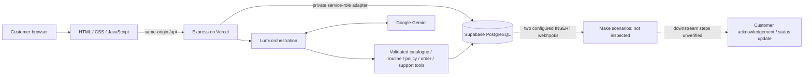

# GlowLab — AI-Assisted Skincare Commerce Platform

A skincare storefront that connects product discovery, a conversational shopping assistant and private order records. GlowLab keeps the shopping interface simple while the server handles catalogue access, prices, guest identity and order persistence.

**[Live storefront](https://glow-lab-puce.vercel.app/)** · [Architecture](docs/architecture.md) · [Workflows](docs/workflows.md) · [Setup](docs/setup.md) · [Testing](docs/testing.md) · [Portfolio case study](docs/portfolio-case-study.md)

> **Demonstration, not a trading store.** Payments are simulated; no products are dispatched. Use fictional customer details. A saved `paid` status with `payment_method=simulated` is not a real payment. This project is not certified production-ready.


_Local browser-test capture, desktop viewport, 13 November 2026. Catalogue-only image: not evidence of live AI or email delivery._

## The problem and objective

Skincare shoppers can struggle to compare products, understand a routine and find useful help without being overwhelmed. Store operators also need reliable order records before they can automate acknowledgement and support.

GlowLab explores both sides of that problem: a coherent customer journey and a backend that makes important actions verifiable. The objectives are to preserve catalogue facts, keep prices authoritative, protect customer records, give the assistant useful tools and distinguish a completed action from a suggestion or failed request.

## What is actually implemented?

| Capability                                                       | Status and evidence                                                                                                                                                                                                                               |
| ---------------------------------------------------------------- | ------------------------------------------------------------------------------------------------------------------------------------------------------------------------------------------------------------------------------------------------- |
| Nine-page responsive storefront                                  | Implemented; desktop, tablet and mobile browser checks pass.                                                                                                                                                                                      |
| Catalogue search, categories and product detail links            | Implemented; 12 original product IDs, prices and images preserved. Missing verified specifications are labelled rather than invented.                                                                                                             |
| Persistent cart and checkout                                     | Implemented; localStorage cart, quantity controls, server-priced checkout and idempotent saves. Browser persistence tested locally.                                                                                                               |
| Supabase orders and item snapshots                               | Implemented; private schema and transactional RPC. Current production read-only catalogue readiness verified; no new production checkout write performed for this audit.                                                                          |
| Lumi AI shopping assistant                                       | **Gemini-only in this revision**, using the official server-side SDK and five model-selected tools. Mock orchestration tests pass; current live generation is not re-certified. Earlier live calls encountered gateway failures and quota limits. |
| Support requests                                                 | Implemented; direct form save or explicit approval of an AI-prepared draft. Not proof of a staffed human support desk.                                                                                                                            |
| Make order acknowledgement                                       | **Partially verified externally:** two enabled Supabase order INSERT HTTP hooks point to Make destinations. Scenario modules, email and status updates are unverified. No Make export or mail integration exists in this source tree.             |
| Groq primary → Gemini fallback                                   | Requested future work, **not implemented**. A configured Groq key alone does not connect a provider.                                                                                                                                              |
| Add to Cart → automatic checkout                                 | Requested future work, **not implemented**. Current flow is Add to cart → Cart → Checkout; checkout does not contain cart-edit controls.                                                                                                          |
| Real payment, fulfilment, seller dashboard, marketing automation | Not implemented or claimed. No Klaviyo integration found in source.                                                                                                                                                                               |

## System at a glance



Solid lines describe implemented application responsibilities, not a claim that every external service is currently available. Dashed lines describe an externally configured, only partially verified automation boundary. [Detailed architecture and API](docs/architecture.md).

## Technology stack

| Technology                            | Responsibility                                                                                                |
| ------------------------------------- | ------------------------------------------------------------------------------------------------------------- |
| HTML, CSS, vanilla browser JavaScript | Storefront, accessible controls, product modal, cart, checkout and chat UI. No frontend framework rebuild.    |
| Node.js + Express 5                   | Shared local/Vercel API, validation, origin checks, guest ownership, errors and static allowlisting.          |
| Zod, Helmet, express-rate-limit       | Request schemas, response headers and per-process abuse controls.                                             |
| Supabase JavaScript SDK + PostgreSQL  | Server-only data access, transactional order creation, item snapshots and private support records.            |
| Google Gen AI SDK                     | Gemini requests and function calling; secrets stay server-side.                                               |
| SQLite                                | Durable **development-only** adapter. Explicitly rejected on Vercel/in production.                            |
| Node test runner + PGlite             | API, security, schema and regression tests. PGlite is local PostgreSQL-compatible testing, not live Supabase. |
| Playwright + packaged Chromium        | Local browser journeys across desktop and touch widths. Gemini transport is mocked only in tests.             |
| Vercel                                | Allowlisted static build and a serverless Express entrypoint.                                                 |
| Make                                  | Externally configured order hooks; downstream scenario behaviour awaits verification.                         |

## How Lumi works

1. The browser sends a message and optional signed conversation token to **one** endpoint: `POST /api/lumi`.
2. The backend verifies session-bound history and supplies the dedicated system instructions and function declarations to Gemini.
3. The model chooses whether a tool is needed. The backend validates the arguments and enforces customer ownership independently of the model.
4. Tool results return to Gemini before the final answer. Product suggestions are tied to catalogue IDs, not invented catalogue entries.
5. The customer explicitly selects cart additions. Support drafts must be reviewed and submitted before a ticket exists.

The five tools are `search_products`, `build_skincare_routine`, `get_store_policy`, `lookup_order` and `create_support_ticket`. Routine selection is implemented server-side from available catalogue records and budget; it is not a clinical assessment or unrestricted semantic personalisation. Conversation history is signed and bounded, **not encrypted**. Lumi must not diagnose, invent policies or expose credentials. [Tool boundaries and limitations](docs/architecture.md#lumi-and-tool-boundaries).

Transient Gemini generation errors can be retried once per round, with a 40-second attempt cap and shared 90-second generation deadline; tools are not replayed by that retry. Authentication, model/request and quota errors are not retried. There is no second-provider fallback in the current code.

## Shopping and order data

- Cart entries are product IDs and integer quantities, persisted in the browser. Add to Cart does not create an order.
- Checkout validates customer fields and quantities; client prices, totals and payment flags are rejected.
- `create_demo_order` loads authoritative product prices, verifies availability, snapshots line items and saves order/items atomically. Tracked stock is decremented only within the transaction.
- An owner-scoped idempotency key plus request fingerprint prevents duplicate order creation on retries; changing the payload under the same key conflicts.
- Initial records distinguish `payment_status=paid`, `payment_method=simulated`, `order_status=confirmed` and `fulfillment_status=unfulfilled`.
- Customer/delivery details are stored in `glowlab.orders.customer`; queryable projections are generated from that snapshot. Purchased items live in `glowlab.order_items`. There is no separate customer-account table or customer login.
- Order lookup requires the originating browser session, reference and checkout email. Email alone does not unlock an order. The service-role credential is never sent to the browser.

## Order acknowledgement automation: evidence, not a promise

The intended boundary is **order INSERT → Make webhook → retrieve committed order/items → generate/send acknowledgement → update notification state**.

Only the first boundary is verified in the live database: **two enabled AFTER INSERT HTTP hooks to Make**, neither configured for UPDATE or DELETE. Two hooks may cause duplicate processing; actual delivery was not tested. The inspected order schema has **no notification-status columns**. No Make blueprint, execution history, mail content or provider receipt was available. Missing line items, email delivery/spam, retries and status-update completion are open checks—not fixes. [Step-by-step evidence and acceptance checklist](docs/workflows.md).

## Run locally

Tested here with Node 22.22.3 and npm. Use Node 22+; browser tests require Linux x64 with the included Chromium setup.

```sh
git clone https://github.com/reedahadedayo-ux/glow-lab.git
cd glow-lab
npm ci
cp .env.example .env
```

For a development preview, set `DATA_BACKEND=local` in your ignored `.env`, optionally set `GEMINI_API_KEY` and an account-supported `GEMINI_MODEL`, then run:

```sh
npm run dev
# http://localhost:3000
```

No AI key means Lumi fails honestly; it does not substitute a scripted answer. Local SQLite data lives in ignored `.data/`. Do not use a generic static server for checkout or expose the repository root as public assets. [Full local/Supabase/deployment instructions](docs/setup.md).

### Environment variable names

`.env.example` intentionally contains **blank values only**. Fill secrets in a private local file or Vercel settings, never in Git.

| Variable                                                                              | Purpose                                                                                                                        |
| ------------------------------------------------------------------------------------- | ------------------------------------------------------------------------------------------------------------------------------ |
| `DATA_BACKEND`                                                                        | `local` for development; `supabase` for deployment.                                                                            |
| `SUPABASE_URL`, `SUPABASE_SERVICE_ROLE_KEY`                                           | Private server adapter connection. Never a browser service-role key.                                                           |
| `SUPABASE_DB_SCHEMA`                                                                  | Commerce schema, normally `glowlab`.                                                                                           |
| `SESSION_SECRET`                                                                      | Stable random secret, at least 32 characters; changing it invalidates session ownership/history.                               |
| `GEMINI_API_KEY`, `GEMINI_MODEL`                                                      | Server-side AI credential and a model currently enabled for the account. Do not assume the source fallback model is available. |
| `APP_ORIGIN`, `PORT`                                                                  | Optional canonical origin and local port.                                                                                      |
| `GLOWLAB_VERIFY_LIVE`, `GLOWLAB_PROBE_DEPLOYED_LUMI`, `GLOWLAB_PROBE_GEMINI_RECOVERY` | Optional preview-only diagnostics. Leave unset unless deliberately performing those checks.                                    |

No Make/Klaviyo/Groq environment variable is consumed by the current application. External database webhooks are managed separately. Do not export their private destinations into documentation.

## Deployment

The existing live storefront is hosted on Vercel from the existing `glow-lab` repository. `vercel.json` builds only root HTML, CSS, browser JS and images into ignored `public/`. `/api/*` forwards to `api/index.js`; legacy storefront paths redirect. Production uses Supabase, not SQLite; secrets are backend environment variables. No migrations run automatically.

This documentation preparation does **not** change Vercel project linkage, redeploy production, modify webhook configuration or apply migrations. `engines.node >=22` can select a newer Vercel major; pin and test an intended runtime before a future hardening release.

## Tests and verification — 13 November 2026

```sh
npm test                 # 40 tests passed
npm run test:browser     # 56 browser groups passed; local SQLite + mocked Gemini
npm run build            # passed
npm run format:check     # passed; formatting, not a separate JavaScript linter
npm audit                # 0 reported vulnerabilities at this check
python3 scripts/audit-publication.py --history
```

An inactive CI template is included at [`docs/ci-workflow.example.yml`](docs/ci-workflow.example.yml); GitHub denied workflow creation with the current connection. Owner activation requires workflow permission.

Read-only production `/api/ready` returned Supabase readiness with 12 catalogue records. This is **not** an order-write, Gemini-response or email-delivery test. No fresh production orders/tickets were created. [Exact evidence, test layers and remaining gates](docs/testing.md).

## Known limitations and next steps

- Make scenario access/export, duplicate-hook review, complete line-item mapping, notification idempotency and delivery/status verification remain open.
- Live Gemini has previously encountered gateway/quota failures. Current health must be tested separately; a configuration flag is not proof of generation.
- Groq priority/fallback and immediate Add to Cart checkout navigation remain unimplemented requirements.
- Product-specific ingredients, volume, usage and benefits lack authoritative verification. Brand names/images are not proof of suitability or authenticity.
- Guest recovery across devices, distributed rate limiting, encrypted/server-side conversation storage and deletion/retention controls need further design.
- No real payments, shipping, refunds, email replies or staffed escalation service is claimed.
- Confirm image redistribution rights and choose a code licence before public presentation. [Publication/security review](docs/security-review.md) and [notice](NOTICE.md).

## Repository and documentation

The source repository remains **private** at `reedahadedayo-ux/glow-lab`. The preferred separate name `glowlab-ecommerce-platform` could not be created: the current GitHub integration denied `createRepository`. No unrelated repository was changed or overwritten. See [manual handoff](docs/github-handoff.md) before moving or publishing anything.

```text
api/                   Vercel handler
server/                Express, Gemini, tools, adapters and security
js/ css/ images/       Maintained browser assets
*.html                 Nine customer-facing pages
supabase/              Reviewed schema, migrations, seed and rollback guidance
scripts/               Build, guarded diagnostics and publication audit
tests/                API, storage, schema, browser and security tests
docs/                 Current architecture, setup, workflows, testing and case study
docs/archive/         Dated historical implementation records
glowlab-skincare/     Legacy redirect pages/assets; not the maintained storefront
```

The 12 older audit reports are archived rather than erased. Their earlier deployment/provider claims are historical, not current readiness guarantees. Git ancestry is preserved. The case study is prepared as Markdown; no changes have been made to the separate portfolio website.
