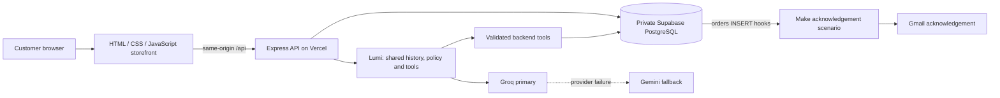

# GlowLab — AI-Assisted Skincare Commerce Platform

A demo skincare ecommerce platform connecting product discovery, Lumi's tool-assisted shopping guidance, private order storage and a Make order-acknowledgement workflow.

**[Live demo](https://glow-lab-puce.vercel.app/)** · [Architecture](docs/architecture.md) · [Setup](docs/setup.md) · [Testing](docs/testing.md) · [Make workflow](docs/workflows.md) · [Portfolio case study](docs/portfolio-case-study.md)

> **Demo, not a trading store.** Payments are simulated, no money is charged and no goods are dispatched. Use fictional customer details. This branch contains the Groq integration; it has not been merged to main or promoted to production. The live site may therefore run an earlier revision.


_Local desktop browser-test capture. No customer record, email or model response is pictured._

## Why GlowLab exists

Skincare shoppers need a clear way to compare products, ask questions and build a manageable routine. Operators need accurate private order records before they can automate useful follow-up.

I built GlowLab to explore both sides: a coherent customer journey and a backend that makes important actions verifiable. The project focuses on catalogue-grounded guidance, server-authoritative prices, explicit customer approvals, transactional order storage and clearly documented automation boundaries—not invented clinical benefits or sales results.

## Features and current evidence

| Capability                           | Implementation and verification                                                                                                                                                                                                                                              |
| ------------------------------------ | ---------------------------------------------------------------------------------------------------------------------------------------------------------------------------------------------------------------------------------------------------------------------------- |
| Responsive storefront                | Nine pages, twelve preserved products, search/category filters and product details; desktop/tablet/mobile browser journeys tested. Unknown ingredients, size and directions are labelled, not invented.                                                                      |
| Cart and simulated checkout          | Persistent cart; quantity/removal; validated checkout; authoritative pricing; atomic order/item snapshots and owner-scoped idempotent retries. Real local API/storage/browser tests pass.                                                                                    |
| Private Supabase records             | Six RLS-enabled commerce tables, backend-only service role and guest-session-scoped order lookup. Live schema/grants inspected read-only; no fresh production order was created.                                                                                             |
| Lumi: Groq primary → Gemini fallback | Implemented and **real-provider tested on a Vercel preview-build host**. Groq `openai/gpt-oss-20b` generated replies and selected a catalogue tool. An injected Groq outage produced a real Gemini `gemini-3.1-flash-lite` response. [Evidence and limits](docs/testing.md). |
| Model-directed tools                 | Catalogue search, basic routine selection, published policy, private order lookup and two-phase support requests. Same validation, ownership and approval boundaries for both providers.                                                                                     |
| Make acknowledgement                 | **Owner reports a successful email test.** Supplied v1 blueprint inspected: webhook → claim → retrieve order/items → aggregate lines → Gmail → status update. [Actual modules, safeguards and reconciliation findings](docs/workflows.md).                                   |
| Support                              | Customer form saves a request; AI-prepared ticket requires explicit review/submit. A saved ticket is not proof of a staffed response or email reply.                                                                                                                         |

## System architecture



The Make line describes the inspected blueprint and owner-reported test, not a fresh audit-triggered email. Its notification RPC/table and some mappings need reconciliation with current live metadata. **Two different Make destinations** are configured on order INSERT; neither was modified. [Workflow evidence](docs/workflows.md).

### Stack

- **Frontend:** HTML, CSS and vanilla JavaScript; original cream/sage/charcoal identity retained.
- **Backend:** Node.js 22.x, Express 5, Zod, Helmet and request limits.
- **Database:** Supabase PostgreSQL + private service-role adapter; SQLite only for explicit local development.
- **AI:** Server-side Groq REST adapter; official Google Gen AI SDK for Gemini fallback. No provider keys or SDK clients in the browser.
- **Automation:** Supabase database HTTP hooks and externally managed Make/Gmail scenario.
- **Verification:** Node test runner, PGlite, Playwright and packaged Chromium. Dedicated mocked-provider tests are clearly separate from live probes.
- **Deployment:** Vercel static asset allowlist plus one Express API entrypoint.

## Lumi: compatible providers, accountable tools

1. Browser sends a message and optional signed history to `POST /api/lumi`.
2. Server verifies guest ownership/history, then sends the shared policy and five tool declarations to **Groq**.
3. Backend validates and executes model-selected tools. Real tool results return to the model before its final answer. Suggestions are not cart mutations.
4. Provider/network/configuration/model/rate errors switch generation to **Gemini**, preserving history and completed tool results. After switching, the request stays on Gemini.
5. Identical tool calls are deduplicated within that request; generation retry/failover does not replay completed actions. Explicit customer approval still governs cart additions and support submission.
6. If both providers fail, Lumi returns a friendly error, not a canned successful answer. The frontend remains provider-agnostic.

Five tools: `search_products`, `build_skincare_routine`, `get_store_policy`, `lookup_order`, `create_support_ticket`. Routine selection uses catalogue availability, budget and metadata—not a diagnosis or clinical suitability guarantee. Signed history protects integrity but is **not encrypted**. Messages and relevant context may reach Groq and Google on fallback. Do not submit sensitive medical/payment information.

Groq attempts are capped at 20 seconds. Gemini generation retains one bounded transient retry; all rounds share a 90-second generation deadline. Tool I/O/serverless limits remain separate constraints. Only allowlisted provider/outcome/status diagnostics are logged. [Provider adapter details](docs/architecture.md#lumi-and-tool-boundaries).

## Checkout and order storage

- Add to Cart changes only browser storage; the current journey is **Cart → Checkout**, not immediate checkout navigation.
- Server rejects client prices/totals/payment flags and loads authoritative catalogue records.
- `create_demo_order` saves an order, item snapshots and tracked stock change atomically. Identical owner-bound retry keys return the saved order; changed payloads conflict.
- Customer/delivery JSON and generated queryable projections live on `glowlab.orders`; purchased names/prices/quantities live in `glowlab.order_items`.
- `payment_status=paid` plus `payment_method=simulated` means simulation complete, not a real charge. `order_status` and `fulfillment_status` remain independent.
- Order lookup requires the originating guest browser, reference and email. No customer account, seller dashboard or email-only recovery is implied.

## Make workflow and sanitised blueprint

[Module-by-module review](docs/workflows.md) · [Sanitised import template](automation/make/README.md)

The owner supplied the actual blueprint and reports successful order-email delivery. The reviewed scenario validates INSERT/orders events, calls a notification claim RPC, waits ten seconds, fetches order/items, iterates and aggregates product rows, sends Gmail, then updates notification status. Retry handlers are present at specific HTTP stages; Gmail has no connected error handler in this export.

The audit also found differences requiring reconciliation: two distinct live webhook destinations, notification objects absent from inspected live metadata, and `item_name` versus stored `product_name`. These do not erase the owner's successful test, nor justify claiming universal retry/deduplication reliability. No production hook/schema/scenario was changed and no email was sent by the audit.

The raw upload contained a privileged credential. Only a sanitised, unbound JSON template is included; private configuration, account bindings and captured metadata were removed. Actual import in Make has not been executed. See the [credential and release gates](docs/security-review.md).

## Run locally

Use **Node 22.x** and npm. The repository is currently private and requires authorised GitHub access.

```sh
git clone https://github.com/reedahadedayo-ux/glow-lab.git
cd glow-lab
npm ci
cp .env.example .env
```

Set `DATA_BACKEND=local` in the ignored `.env`; optionally configure the AI variables privately, then:

```sh
npm run dev
# http://localhost:3000
```

No provider key means honest AI unavailability, not scripted answers. Local SQLite lives in ignored `.data/` and is rejected on Vercel/in production. Browser tests require the bundled Linux x64 Chromium setup. Do not expose the repo root with a generic static server. [Complete setup](docs/setup.md).

### Environment names

`.env.example` contains **blank assignments only**. Secrets belong in private server settings.

| Name                                                              | Purpose                                                                                            |
| ----------------------------------------------------------------- | -------------------------------------------------------------------------------------------------- |
| `DATA_BACKEND`                                                    | Explicit `local` development or `supabase` central persistence.                                    |
| `SUPABASE_URL`, `SUPABASE_SERVICE_ROLE_KEY`, `SUPABASE_DB_SCHEMA` | Private server adapter; schema normally `glowlab`. No service-role key in the browser.             |
| `SESSION_SECRET`                                                  | Stable random secret of at least 32 characters. Rotation invalidates guest ownership/capabilities. |
| `GROQ_API_KEY`, `GROQ_MODEL`                                      | Primary provider; default model `openai/gpt-oss-20b`.                                              |
| `GEMINI_API_KEY`, `GEMINI_MODEL`                                  | Fallback provider; default `gemini-3.1-flash-lite`. Account availability still matters.            |
| `PORT`, `APP_ORIGIN`                                              | Optional local port/canonical mutation origin.                                                     |
| `GLOWLAB_VERIFY_PROVIDERS`                                        | Explicit preview-build-only read-only real-provider probe. Disabled normally.                      |
| Other `GLOWLAB_*` diagnostics                                     | Existing opt-in probes; review [setup](docs/setup.md) before enabling.                             |

Make connections/webhooks are configured externally, not consumed through application webhook variables. Existing private Vercel Make variables were preserved. No Klaviyo implementation was found.

## Verification

```sh
npm test                         # 50 automated tests
npm run test:browser              # 56 storefront groups; real local SQLite, mocked Gemini
npm run test:browser:providers    # 3 primary/fallback/error frontend scenarios; mocked providers
python3 -m unittest discover -s tests -p '*_test.py'  # 4 publication-tool tests
npm run build
npm run format:check              # formatting, not a separate JS linter
npm audit
python3 scripts/check-doc-links.py
python3 scripts/audit-publication.py --all-refs
```

Real Groq and Gemini fallback responses were verified separately in protected Vercel preview-build probes, including an HTTP contract check. Local browser tests verify response rendering with mocked transports. They do not claim a full live-provider browser journey or a new production order/email test. [Exact evidence](docs/testing.md) · [Sanitised probe results](docs/evidence/provider-probes.json).

## Deployment and known limits

`vercel.json` builds only public HTML/CSS/browser JS/images, routes `/api/*` to `api/index.js`, retains legacy redirects and configures headers. Production requires Supabase and stable secrets; migrations are not run automatically. Node is pinned to the locally tested 22.x major instead of a floating `>=22` range.

This branch remains private and unmerged. No production deployment was promoted. Before an approved release, reconcile the existing production `GEMINI_MODEL` override with the tested fallback model; final secret scopes and preview setup are explained in [setup](docs/setup.md).

Remaining limitations include Make configuration reconciliation/failure tests, verified product specifications, guest recovery/retention controls, per-process rather than distributed rate limiting, and the planned direct-checkout flow. No real payments, shipping, monetary refunds, marketing automation, clinical verification or staffed escalation SLA is claimed.

## Public-release review

**Prepared for owner review, not automatically cleared for publication.** [Release audit and file inventory](docs/release-audit.md) · [Security review](docs/security-review.md) · [Asset rights inventory](docs/assets-and-licensing.md) · [Notice](NOTICE.md).

No confirmed credential was found in the reviewed Git tree/history; the private raw blueprint was never committed. Author metadata, historic test identifiers, asset permissions, licence choice and credential-rotation decisions still need owner review. An inactive CI template is provided because the GitHub integration lacks workflow-write permission. Repository visibility and main remain unchanged.

```text
api/                    Vercel API entrypoint
server/                 Express, provider adapters, tools, storage and security
js/ css/ images/        Maintained storefront assets
*.html                  Nine customer-facing pages
supabase/               Reviewed migrations/seed/rollback guidance
scripts/ tests/         Build, diagnostics, security and regression helpers
automation/make/        Sanitised supplied blueprint and rebinding guide
docs/                   Current architecture, evidence, setup, case study and audit
docs/archive/           Earlier implementation records, explicitly historical
glowlab-skincare/       Preserved legacy redirect pages/assets
```

The separate portfolio website was not changed. The [case study](docs/portfolio-case-study.md) is ready to adapt without invented performance, revenue or customer outcomes.
