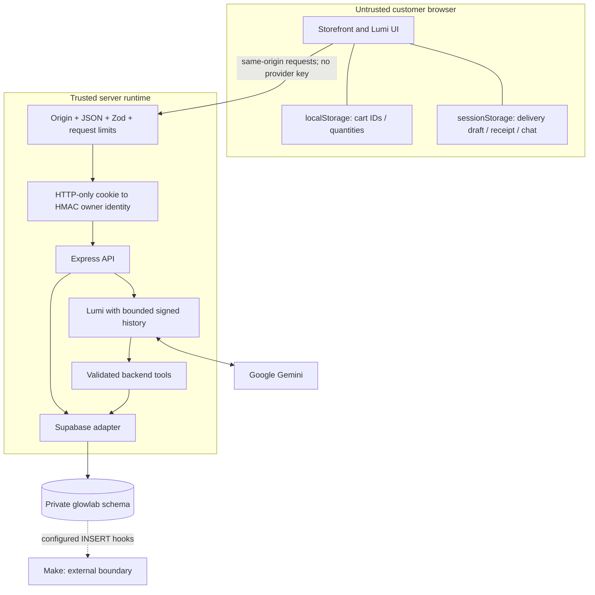
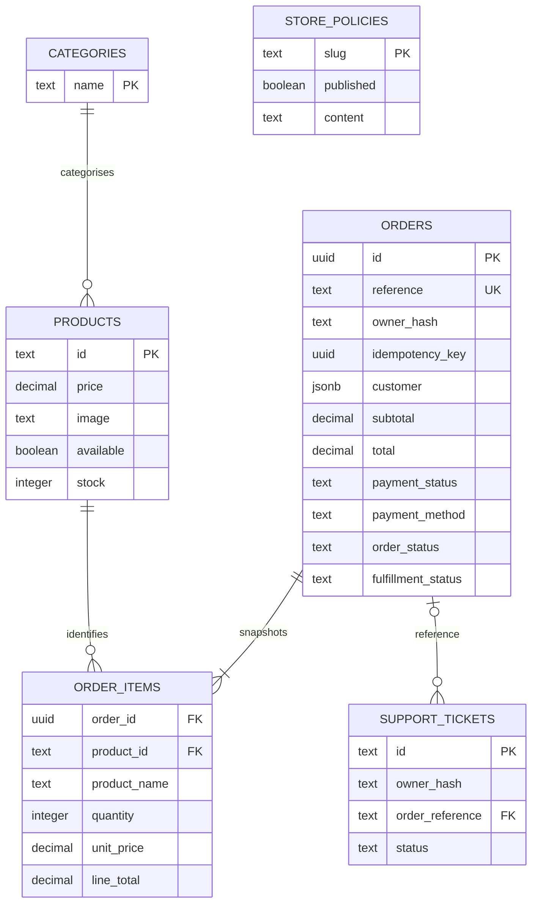

# System architecture

[README](../README.md) · [Workflows](workflows.md) · [Setup](setup.md) · [Testing](testing.md)

**Snapshot: 13 November 2026.** This describes the checked-out implementation, not the previously requested Groq migration. See [workflow evidence](workflows.md) for database changes configured outside Git.

## Components and responsibilities

| Component          | Source                                                      | Responsibility                                                                                                                         |
| ------------------ | ----------------------------------------------------------- | -------------------------------------------------------------------------------------------------------------------------------------- |
| Customer pages     | Root HTML, `css/style.css`                                  | Home, Products, About, FAQ, Contact, Cart, Checkout, Confirmation and Policies.                                                        |
| Browser controller | `js/script.js`                                              | Same-origin API requests, catalogue filtering, modal, persisted cart, checkout and Lumi panel.                                         |
| Copy presentation  | `js/storefront-copy.js`                                     | Only exact known legacy descriptions/policies are translated for display. Future configured content passes through. No database write. |
| Vercel entrypoint  | `api/index.js`                                              | Lazily creates/caches the same Express application used locally. Startup failure returns a configuration error.                        |
| Runtime            | `server/runtime.js`                                         | Selects Supabase or explicit development-only SQLite. Production refuses local mode.                                                   |
| API/security       | `server/app.js`, `security.js`, `validation.js`             | Origin/JSON/body checks, validation, session ownership, signed capabilities, rate limits and safe error responses.                     |
| Data adapters      | `supabase-store.js`, `local-store.js`, `database-errors.js` | Same application operations with different storage implementations; sanitized integration failures.                                    |
| AI                 | `lumi.js`, `lumi-system-prompt.js`, `gemini-request.js`     | Official Gemini SDK, conversation context, tool loop, generation-only transient recovery.                                              |
| Tools              | `server/tools.js`                                           | Validated catalogue/policy reads, routine selection, secure order lookup, two-phase ticket action.                                     |
| Deployment         | `vercel.json`, `scripts/build-public.js`                    | Public asset allowlist, API rewrite, security headers, clean URLs and old-path redirects.                                              |
| External workflow  | Supabase configuration, not source code                     | Two enabled order INSERT webhook triggers to Make. Downstream scenario unverified.                                                     |

## Trust boundaries



The browser never receives a Supabase service-role or AI credential. The backend service role deliberately bypasses RLS, so ownership checks must remain on every customer record access path. The assistant cannot choose an owner hash through a tool argument.

## Guest identity, not customer accounts

- A random 256-bit `glowlab_session` cookie is HttpOnly, SameSite=Lax, 30 days and Secure in production.
- `SESSION_SECRET` derives an HMAC owner hash. Store/order lookup compares that owner plus reference and email. There is no customer login, seller dashboard or email-only recovery.
- Losing the cookie or rotating the secret can lose guest order access. Contact records a request; it does not guarantee identity recovery.
- Conversation and support tokens are signed, owner-bound and expire. **Signing is integrity, not encryption**: their encoded contents are browser-readable. Do not put payment or sensitive medical information into chat.
- Browser drafts/transcripts can contain entered personal information. Use fictional data; retention, deletion requests and stronger shared-device protections need further work.

## Data model



The real SQL definitions, constraints and privileges are in [migrations](../supabase/migrations/). There are six commerce tables. No separate `customers` table is required: the purchase-time customer/delivery snapshot belongs to the order. Generated columns expose name/email/phone/address/city/instructions from that JSON without competing copies. `shipping_fee` is derived from stored `delivery_fee`.

Anonymous/authenticated roles have no private commerce access in the reviewed migration contract; RLS is enabled. Live grants were not independently re-certified in this audit. The migrations do not define notification state, an outbox or the two externally configured HTTP hooks. That is explicit **configuration drift**, not an invitation to rerun SQL.

## Checkout transaction and retry behaviour

```mermaid
sequenceDiagram
    participant C as Customer
    participant B as Browser
    participant A as Express
    participant D as Supabase RPC
    C->>B: Submit checkout + simulation consent
    B->>A: IDs, quantities, customer, idempotency UUID
    A->>A: Validate and fingerprint normalized payload
    A->>D: create_demo_order(owner, input, key, fingerprint)
    D->>D: Lock owner/key; find existing result
    alt Same key and same payload
        D-->>A: Existing order (no new INSERT)
    else New request
        D->>D: Lock products; price and validate stock
        D->>D: Save order + item snapshots + tracked stock atomically
        D-->>A: Saved order
    end
    A-->>B: 201 with saved record
    B->>A: Confirmation lookup (owner + reference + email)
    A-->>B: Persisted order status
    Note over D: External AFTER INSERT hooks may enqueue Make notifications
```

`checkoutSchema` permits 1–30 unique lines, integer quantities 1–20 and validated contact/delivery input. It rejects supplied totals/prices/payment flags. The transaction uses an advisory lock for the owner/retry key and stable product-row locking; a mismatch under an existing key conflicts. Immutable item snapshots preserve purchased names/prices even if catalogue entries later change. Failure rolls back stock and order. Null stock means untracked, not an invented inventory number.

This prevents duplicate **orders**, not duplicate **emails**. External hooks, webhook delivery and sender retries need their own notification idempotency strategy. An asynchronous webhook can arrive before separate item queries observe committed data; the external scenario must retrieve with bounded retry and validate all items. That behaviour is not verified here.

## Lumi and tool boundaries

Current provider: **Google Gemini via `@google/genai`**. Source default is `gemini-2.5-flash`; earlier deployment evidence used an environment override `gemini-3.5-flash`. Neither is a guarantee of current account availability. There is no Groq client, Groq model selection or provider fallback in this revision.

The backend sends the dedicated system instruction, bounded history, five tool declarations, temperature 0.2 and output limit 1400 to `generateContent`. Up to six model rounds are allowed, with at most five tool calls in a round. Whole history turns are trimmed to 24 entries / roughly 48,000 JSON characters where possible and sealed with a two-hour expiry.

| Tool                     | Actual behaviour                                                                                                             | Important limit                                                                                                          |
| ------------------------ | ---------------------------------------------------------------------------------------------------------------------------- | ------------------------------------------------------------------------------------------------------------------------ |
| `search_products`        | Reads adapter catalogue; matches query words/category and returns up to 12 public records.                                   | Keyword matching, not embeddings or a medical suitability engine.                                                        |
| `build_skincare_routine` | Chooses available cleanser/moisturizer/sunscreen using budget and skin-type labels; supplies morning/evening IDs and totals. | Preferences are accepted but not deeply ranked; cheaper fallback may be chosen. Labels are unverified shopping metadata. |
| `get_store_policy`       | Returns published matching policy records.                                                                                   | Unknown topics remain unknown. Backend legacy wording may differ from narrow storefront copy adaptations.                |
| `lookup_order`           | Enforces owner/reference/email and returns limited order/item/status data.                                                   | Does not send stored address/phone to the model; no cross-device email-only recovery.                                    |
| `create_support_ticket`  | Validates a draft and creates an expiring signed review token; UI confirmation then persists.                                | Draft is not a saved ticket; no verified human agent notification is implied.                                            |

Customer selections, not AI text, add products to cart. The support confirmation route validates owner/history/token and uses the same server tool with verified approval context. Unrecognized tools fail rather than run arbitrary functions.

`generateWithRecovery` retries model generation at most once for transient 502/503/504, abort/timeout or specific network failure. Per-attempt cap is 40 seconds, with a shared 90-second generation deadline; validation/auth/model/quota failures are not retried. Tool execution stays outside this retry, preventing a generation retry from replaying a tool. Tool I/O time and serverless limits still require monitoring. There is no fabricated answer when generation fails.

## API contract

All API responses are marked no-store. Mutating endpoints require JSON and allowed same-origin requests (or `APP_ORIGIN`).

| Method | Route                                | Role                                                                                                 |
| ------ | ------------------------------------ | ---------------------------------------------------------------------------------------------------- |
| GET    | `/api/config`                        | Nonsecret mode/configuration flags; not proof of external-service health.                            |
| GET    | `/api/ready`                         | Actual catalogue read; includes count and Gemini-configured flag, not generation/email verification. |
| GET    | `/api/products`, `/api/products/:id` | Public product projection, with unverified ingredients/usage suppressed.                             |
| GET    | `/api/policies`                      | Published backend policy records.                                                                    |
| POST   | `/api/checkout`                      | Validate and persist a simulated order.                                                              |
| POST   | `/api/orders/lookup`                 | Owner/reference/email-scoped saved record.                                                           |
| POST   | `/api/support`                       | Persist an explicit customer support request.                                                        |
| POST   | `/api/support/confirm`               | Persist approved AI-prepared draft.                                                                  |
| POST   | `/api/lumi`                          | Model response, product/routine suggestions, optional ticket draft and signed history.               |

Typical errors: 400 validation; 403 ownership/origin; 404 unknown or unverifiable record; 409 stock/retry conflict; 429 request/provider limit; 502 empty/malformed AI response; 503 missing/unavailable integration. Errors contain sanitized messages/codes and request IDs, not raw credentials. Database reads are bounded by adapter timeouts. Request limits use process memory: they are not a distributed serverless firewall.

## Deployment and non-goals

The build copies only public HTML/CSS/JS/images. Express also allowlists served paths; source, migrations and `.env` are not public assets. Vercel rewrites API traffic to one shared handler, retains clean URLs and redirects legacy paths. The Node engine range is broad; record/pin a tested major before a future runtime change.

No checkout/order migration, production environment change, Groq migration, real charge, mail service or Make scenario change was performed by the documentation preparation. The separate portfolio website is not part of this checkout.
