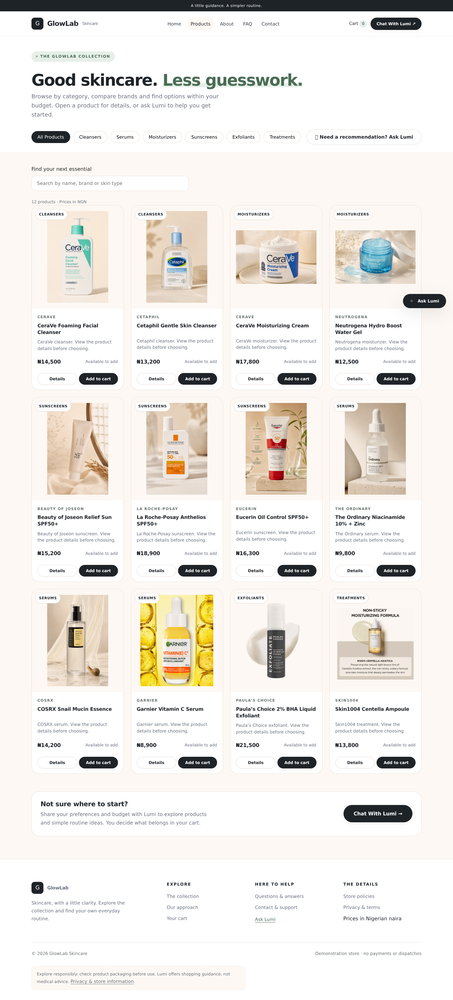
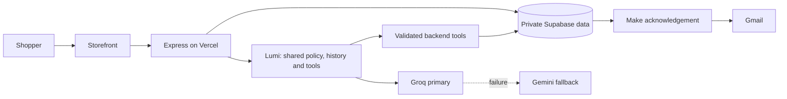

# GlowLab — AI-Assisted Skincare Commerce Platform

**A demo skincare shopping experience combining product discovery, tool-assisted AI guidance, private order records and an order-acknowledgement automation.**

[Live demo](https://glow-lab-puce.vercel.app/) · [Source — private until review](https://github.com/reedahadedayo-ux/glow-lab/tree/arena/7e7ec798-glow-lab) · [Architecture](architecture.md) · [Evidence](testing.md)

> Prepared 13 November 2026. Payments are simulated; no money is charged and no goods are dispatched. This prepared branch has not been merged or promoted, so the public live site may run an earlier revision. No sales, customer-satisfaction or time-saving metrics are claimed.

_Actual local browser-test capture; catalogue-only, no customer record or AI response._

## The problem

A skincare store has two jobs: help a customer make sense of products, and retain accurate order information for follow-up. A polished interface alone does not solve private recordkeeping; an AI chat bubble alone does not make recommendations trustworthy.

I built GlowLab to connect these responsibilities. The goal was a coherent customer journey backed by verifiable actions: catalogue-grounded guidance, authoritative pricing, explicit approval and stored order/item snapshots. Behind it, the acknowledgement workflow explores how commerce events can drive practical operations without making the storefront look like an automation dashboard.

## Customer experience and system design

The cream, sage and charcoal identity carries through browsing, product details, cart, checkout and support. The customer can search/filter twelve original products, inspect the information available, adjust a persistent cart and save a simulated order. Where ingredient, size or usage details could not be verified, I label the gap instead of inventing confident product copy.

The maintained frontend uses HTML/CSS/vanilla JavaScript. A Node/Express API owns input validation, guest identity and data operations. Supabase stores private orders and purchased-item snapshots; Vercel hosts the allowlisted public assets and API entrypoint. SQLite gives local development/tests real persistence without pretending that it is production Supabase.

The service-role and AI keys remain on the server. Customer order access is scoped to the guest browser that placed the order, reference and checkout email. Knowing another person's email is not enough to retrieve their order. This is a guest flow, not a full account/recovery system.

## Lumi: useful assistance with accountable actions

Lumi's primary model is now **Groq `openai/gpt-oss-20b`**. On provider, model, configuration, network or quota failure, generation switches to **Gemini `gemini-3.1-flash-lite`**. Both receive the same dedicated instructions and backend tool declarations; the browser uses one provider-agnostic endpoint.

I kept one shared orchestration loop instead of rebuilding the assistant for each SDK. The Groq adapter translates the canonical history/tool format; the fallback retains completed tool results and stays selected for later rounds in that request. Identical tool calls are deduplicated within a request, while generation retries never replay completed tools.

The five functions search the real catalogue, build a basic budget-aware routine, retrieve published policy, look up a session-owned order and prepare a support request. The model chooses tools, but server validation and ownership decide what can run. Product suggestions do not mutate the cart. A support draft requires customer review/submit before a saved ticket ID establishes success.

That separation is important: conversational text is not a transaction. Routine selection is a shopping aid using catalogue metadata—not a clinical diagnosis, ingredient certification or medical suitability guarantee. Signed history is integrity-protected, not encrypted; customer messages/relevant context can reach both providers during fallback.

## Simulated commerce with durable records

The browser submits product IDs and quantities, not trusted prices or a payment flag. The server fingerprints the validated request and calls a transactional Supabase function. It prices from authoritative product rows and saves the order, purchased-item snapshots and tracked stock change atomically.

An owner-scoped idempotency key returns an existing order for an identical retry; a different payload under the same key conflicts. Immutable names/prices protect the purchase snapshot from later catalogue edits. Payment, order and fulfilment state remain separate: a simulated paid order is still unfulfilled and is not a provider receipt.

Customer/delivery details belong to the private order JSON snapshot, with generated queryable projections. Confirmation retrieves the saved record rather than assembling a success message only from browser input. That is a useful foundation for reconciliation and customer assistance—not evidence of real trading or a seller operations dashboard.

## The actual acknowledgement automation

I have successfully tested order-email delivery. The supplied Make v1 blueprint documents the intended operational sequence: Supabase order INSERT → webhook → notification claim → ten-second delay → order with nested items → iterator/HTML row aggregation → Gmail → notification-status update.

The scenario uses deterministic email HTML, not an LLM-generated acknowledgement. Specific HTTP steps have Break/retry handlers and a missing-email failure branch. Its structure demonstrates the connection between an ecommerce event, data retrieval, message composition and operational state.

The technical audit also made the boundary more precise. Two distinct Make webhook destinations are enabled on order INSERT. The supplied v1 references notification objects not found in the inspected live schema, and uses an item-name field that differs from the current app schema. Its Gmail failure route is disconnected in the designer export. Those findings do not invalidate my successful test, but they do mean the exact working revision, duplicate handling and error recovery need reconciliation before I claim universal reliability.

I kept the working external configuration unchanged. The repository contains a sanitised, unbound blueprint template—not a credential-bearing export or a claim of a freshly verified import. The raw export embedded a privileged credential, so rotation/rebinding needs an owner-controlled process.

## Testing and real evidence

Fresh local checks passed **50 automated tests**, **56 storefront browser groups**, **three provider frontend scenarios** and **four Python publication-tool tests**. Coverage includes authoritative pricing, private access, idempotent/concurrent retries, saved local snapshots, support approval, provider conversion/fallback, malformed output and secret redaction. The browser suite covers desktop/tablet/mobile plus honest outage/empty states.

Separately, Vercel preview-build probes verified real Groq replies and tool use, then a successful real Gemini fallback after an injected Groq outage. A real Groq call through the Express frontend response contract returned HTTP 200. The first fallback attempt returned 404 for an old default model; changing to a supported Flash Lite default and retesting produced success.

The limits are explicit: browser provider tests mock external transports, the live HTTP contract ran inside the preview-build host rather than a deployed protected browser session, and no new production order or customer email was created for the audit. A second catalogue probe ran the tool but did not return the requested target metadata, so I do not equate tool execution with guaranteed answer relevance.

Build/format checks passed and npm audits reported zero known vulnerabilities at the check. These are verification results—not performance, revenue, conversion or customer-outcome metrics.

## Challenges and decisions

- **Provider resilience without duplicate actions:** preserve canonical history/tool results, retry generation only, keep fallback sticky within a request and deduplicate identical tool execution.
- **Honest AI and commerce:** keep approval, saved-record evidence, simulation and medical boundaries visible without filling the storefront with development language.
- **Automation configuration drift:** separate owner-tested delivery, inspected blueprint design and live schema metadata rather than turning one diagram into a blanket success claim.
- **Privacy before publication:** remove raw automation credentials/bindings, inventory inherited author metadata and preserve history pending explicit privacy decisions.
- **Refine rather than restart:** retain the original catalogue relationships, brand, API route and Vercel/Supabase architecture.

## Next steps

Reconcile the actual working Make scenario/revision, map both destinations, verify the notification claim/uniqueness contract and attach/test appropriate send-error handling with approved staging data. Review production's fallback model override before any rollout. Broaden live multi-turn provider testing and improve retention, guest recovery and distributed abuse controls.

The separately requested immediate Add to Cart → checkout journey remains planned; the working cart-review flow is retained. Real payment, fulfilment, marketing/Klaviyo automation and staffed response promises are not implemented or claimed.

Before public visibility, confirm image permissions, choose a code licence, resolve credential-rotation and author-privacy decisions, and review final repository artifacts. The separate portfolio website has not been modified; this factual case study can be adapted there after review.

## What the project demonstrates

GlowLab demonstrates the engineering behind an AI-assisted customer journey: validated data, private records, explicit approvals, transactional writes, provider fallback and automation evidence. Its value as a portfolio project is not that every operational edge is finished—it is that the implemented behaviour and remaining boundaries can be explained and tested honestly.
