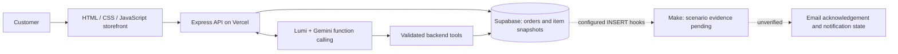

# GlowLab — AI-Assisted Skincare Commerce Platform

**A skincare shopping experience combining product discovery, AI-powered customer assistance and a foundation for automated order operations.**

[Live demonstration](https://glow-lab-puce.vercel.app/) · [Source repository — currently private](https://github.com/reedahadedayo-ux/glow-lab) · [Technical architecture](architecture.md) · [Verification](testing.md)

> Portfolio-use copy, prepared 13 November 2026. Payments are simulated and no products are dispatched. The Make order-notification boundary is configured but downstream email operation is not yet verified. This is an engineering demonstration, not evidence of live sales, customer results or a production-ready retail business.

_Local test capture, desktop viewport; no customer record or AI response is pictured._

## The problem

A skincare store has two different jobs to do well. Customers need a clear way to compare products and ask questions without being pushed into a complicated routine. Behind that interface, order information needs to be accurate and private before it can feed useful operations.

GlowLab brings those jobs together. The aim was not to put an AI chat bubble on a static catalogue. It was to connect shopping guidance to the same product and order data the storefront uses—and to make the boundaries visible when an action has not actually completed.

## The system I designed and built

The customer journey stays deliberately familiar: browse products, open details, add items to a persistent cart, review quantities, complete a simulated checkout and retrieve the saved confirmation. The cream, sage and charcoal identity carries through product discovery, checkout and support rather than turning the store into an automation dashboard.

Under that interface, a Node/Express backend owns price validation, guest-session identity and persistence. Supabase stores orders and purchased-item snapshots. Lumi, the AI shopping companion, can ask that backend for catalogue information and order status; it cannot simply claim that an order was found or a ticket was created.

The maintained catalogue contains twelve products. IDs, prices and image relationships were preserved during the storefront refinement. Where ingredients, directions or size could not be verified, the interface says so instead of filling the gaps with confident marketing copy.

## Technical architecture

The implementation uses vanilla frontend code, not a replacement framework. The same Express application runs locally and behind Vercel's API entrypoint. Local SQLite gives the test suite a real persistence layer; deployed mode requires Supabase and does not silently substitute a local database if configuration fails.

The private service-role connection and AI key remain on the server. Customer order lookup is scoped to the browser session that placed the order plus its reference and checkout email. Knowing an email address is not enough to read another shopper's order.

## Lumi: assistance grounded in actual tools

Lumi currently uses the official Google Gemini SDK with a dedicated server-side policy. The model can choose five functions:

- Search the actual catalogue.
- Build a basic routine from available products and a budget.
- Read published store policies.
- Look up a session-owned order.
- Prepare a support request for explicit customer approval.

The backend validates arguments and supplies real tool results before the assistant writes its final answer. Product selections stay under the customer's control. A support draft is shown for review; it is not reported as a saved ticket until the customer submits it and the database returns success.

That distinction is central to the project. Conversational text is not a transaction, and a plausible answer is not evidence that a tool ran. The implementation also distinguishes skincare shopping guidance from diagnosis. Routine selection uses catalogue metadata and budget rules, not a claim of clinical suitability.

Groq-primary/Gemini-fallback routing has been requested but is not implemented in this revision. I would not present a configured API key as a completed integration.

## Checkout and order-processing workflow

The browser sends product IDs and quantities, not trusted prices or a chosen payment status. The server validates input, retrieves catalogue prices and asks a transactional Supabase function to save the order and its line items together.

An owner-scoped idempotency key and request fingerprint make an identical retry return the existing order rather than create a second one. Purchased names and prices are snapshotted so a later catalogue update cannot rewrite the customer's purchase record. Payment, order and fulfilment status are separate: simulated payment can be complete while the order remains unfulfilled.

Customer name, email, phone and delivery details are stored with the private order snapshot, with generated queryable columns. The confirmation page retrieves that saved order rather than inventing a receipt from browser values. This provides the foundation an operator would need for reconciliation, support and a later acknowledgement workflow without claiming those business outcomes have already occurred.

## Automation logic: what is verified and what is not

The intended acknowledgement flow is order INSERT → Make webhook → retrieve order and all items → assemble/send acknowledgement → record notification outcome.

The audit found **two enabled Supabase AFTER INSERT hooks to Make destinations**. That establishes a configured database-to-automation boundary. It does not prove that the Make scenario retrieves the items, sends the email or updates status correctly.

No scenario blueprint, email delivery evidence or notification-status implementation was available to inspect. Two hooks also create a duplicate-processing risk worth resolving before claiming reliable notifications. Missing item lines, retry/idempotency rules, inbox/spam placement and notification outcome persistence remain explicit acceptance gates.

For an operator, the intended value is straightforward: reduce manual acknowledgement work and keep orders visible when delivery of a message fails. Those are design goals—not measured time savings, proven delivery rates or customer results for this project.

## Testing and verified results

Fresh local checks on 13 November 2026 produced:

- **40 passing automated tests**, covering checkout snapshots, pricing, idempotency, private access, support approval, schema behaviour, AI orchestration and redaction.
- **56 passing browser groups** across desktop, tablet and mobile, including saved local customer snapshots and complete checkout/confirmation journeys.
- Successful build and formatting checks; dependency audit reported no known vulnerabilities at that check.
- A read-only production readiness response confirming a Supabase catalogue read with twelve records.

These numbers are verification scope, not performance or business metrics. Browser tests use real local Express/SQLite and a mock Gemini transport. PGlite migration tests are not live Supabase tests. This audit did not create production orders, call live AI or send customer emails.

## Engineering challenges and decisions

**Keeping customer experience separate from project evidence.** The storefront now reads like a coherent shop, while a concise disclosure and checkout consent keep the simulation honest. Detailed development records belong in documentation, not repeated sales-page banners.

**Making AI actions accountable.** Model-selected tools share backend validation and ownership rules with normal routes. Explicit approval separates an AI-prepared support draft from persistence.

**Handling uncertain integration outcomes.** Earlier Gemini requests produced gateway errors and quota limits. Bounded generation-only recovery improves the failure path without replaying tools or fabricating an answer. Availability still needs real provider checks; local mocks do not certify it.

**Recognising configuration drift.** Live Make hooks exist outside the SQL migrations and application code. The documentation distinguishes observed external configuration from a reproducible, verified workflow. It avoids turning an intended diagram into a claim of implementation.

**Preserving a working codebase.** The project was refined in place, preserving catalogue relationships, Git ancestry and the existing Vercel/Supabase architecture instead of starting over.

## Current limitations and next improvements

1. Inspect a sanitised Make scenario and verify every order/item mapping, sender outcome and status update. Resolve the two-hook intent and implement/review notification deduplication before claiming reliable acknowledgement.
2. Implement and test Groq-primary/Gemini fallback, including shared context, technical failover and no duplicate tool actions.
3. Implement the separately requested Add to Cart → direct checkout flow with single-add protection and checkout-side editing. Current cart navigation remains unchanged.
4. Obtain authoritative product specifications, and address guest recovery, distributed rate limits, conversation privacy and retention controls.
5. Confirm asset redistribution rights and choose a code licence before public release. The repository remains private until the owner approves publication.

## Portfolio positioning

GlowLab demonstrates the engineering discipline behind an AI-assisted customer journey: validated data, private records, explicit approvals, transactional writes and honest failure states. The strongest current outcome is a tested application foundation with clearly documented operational boundaries—not a claim that every automation is finished.

This Markdown is ready to adapt for the owner's portfolio website. It has not been published to, or integrated with, that separate website. When the preferred GitHub repository is created and reviewed, replace the private source link above; add email or live-AI outcomes only after collecting the corresponding evidence.
