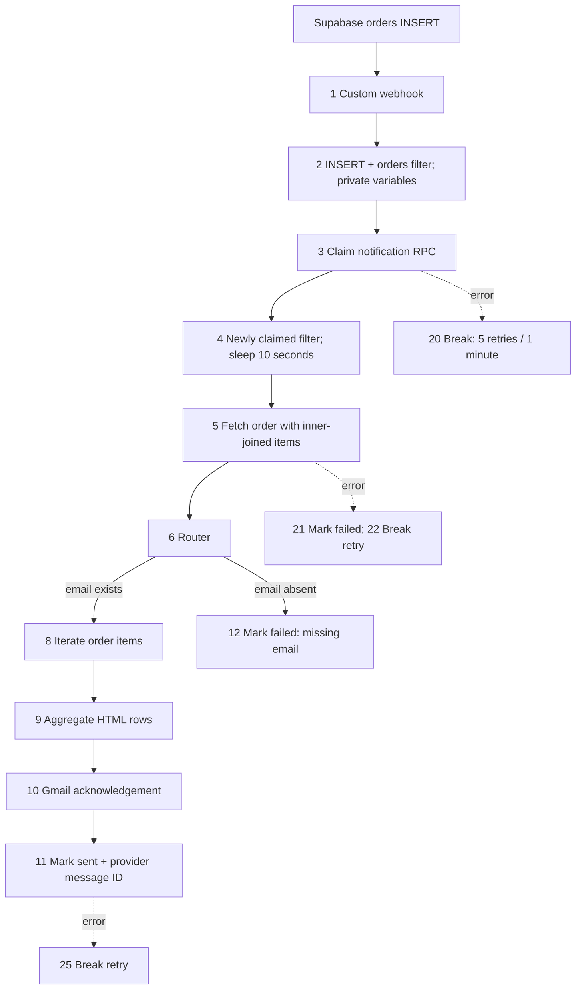

# Order, AI and Make workflows

[README](../README.md) · [Architecture](architecture.md) · [Test evidence](testing.md)

**Evidence updated 13 November 2026.** The owner reports having successfully tested order acknowledgement emails. The actual supplied v1 blueprint has now been inspected. This replaces the earlier access-limited assessment; successful delivery is **owner-reported**, module behaviour below is **blueprint-inspected**, and live schema/trigger findings are **read-only metadata observations**. No fresh email or production order was sent by this audit.

## Application checkout

Add to Cart only changes browser storage. Cart review → checkout validates contact/delivery fields and product IDs/quantities → server computes a request fingerprint → `glowlab.create_demo_order` validates authoritative catalogue prices and atomically saves order/item snapshots/stock changes. Identical owner-bound retries return the existing order, not another INSERT. A changed payload under the same key conflicts.

Limited order status lookup verifies the complete reference and checkout email from any browser. Full confirmations and order-linked support still require the originating guest session. Payment, order and fulfilment state remain independent; simulated `paid` is not a charge, receipt or shipment. Local API/schema/browser tests cover this; no new production write was authorised or performed.

## Actual supplied Make v1 sequence

### Module-by-module mapping

| ID / module                   | Inspected configuration                                                                                                                                       | Meaning and limits                                                                                                                                                                                |
| ----------------------------- | ------------------------------------------------------------------------------------------------------------------------------------------------------------- | ------------------------------------------------------------------------------------------------------------------------------------------------------------------------------------------------- |
| 1 `gateway:CustomWebHook`     | Existing private hook binding, `maxResults=1`.                                                                                                                | Receives database webhook event. Hook URL/ID removed in public template; not invoked during review.                                                                                               |
| 2 `util:SetVariables`         | Filter `1.type = INSERT` AND `1.table = orders`; variables `supabase_url`, `service_key`.                                                                     | Validates event type/table but not schema, signature or sender identity. Original credential removed from template.                                                                               |
| 3 `http:ActionSendData`       | POST `/rest/v1/rpc/claim_order_notification`; JSON `p_order_id=1.record.id`, `p_type=order_acknowledgement`; API key/Bearer mapped from module 2.             | Intended database claim before sending. Function implementation/atomic uniqueness cannot be established from the blueprint alone. No Content-Profile header in supplied v1.                       |
| 4 `util:FunctionSleep`        | Continue only when `length(3.data) > 0`; sleep **10 seconds**.                                                                                                | Empty claim response suppresses further processing; fixed delay allows item commit timing but is not a bounded item-polling loop.                                                                 |
| 5 HTTP GET                    | `/rest/v1/orders?id=eq.{{1.record.id}}&select=*,order_items!inner(*)`; `Accept-Profile: glowlab`, parsed response, 40-second timeout.                         | Retrieves committed order plus nested item relationship rather than relying on order INSERT payload for lines. Exact parsed bundle shape still needs reconciliation with the working execution.   |
| 6 router                      | Two branches by existence of `1.record.customer_email`.                                                                                                       | Tests field existence, not email syntax or a non-empty string. Checkout validates email, but arbitrary direct webhook data is a separate boundary.                                                |
| 8 `builtin:BasicFeeder`       | Iterates `5.data.order_items`.                                                                                                                                | Assumes that exact response shape. A raw PostgREST GET normally returns an array; Make's parsed/bundled output should be checked against the successful run, not guessed.                         |
| 9 `util:TextAggregator`       | Feeder 8; HTML row uses `8.item_name`, `8.quantity`, `8.unit_price`; row subtotal `quantity * unit_price`.                                                    | Produces multi-product rows. Current app schema uses **`product_name`**, not `item_name`; v1 mapping is preserved and discrepancy documented, not silently rewritten.                             |
| 10 `google-email:sendAnEmail` | Recipient `1.record.customer_email`; subject includes reference; raw HTML body embeds `9.text`; uses configured Gmail connection.                             | Deterministic template, no LLM email generation. Greeting/reference/payment/total use original webhook fields. Owner reports successful delivery; no new mailbox/provider receipt inspected here. |
| 11 HTTP PATCH                 | `/rest/v1/order_notifications` filtered by order ID + notification type. Sets `status=sent`, `sent_at=now`, `provider_message_id=10.id`, clears `last_error`. | Tracks notification independently of order/payment/fulfilment. No Content-Profile header. Actual target table not found in current live metadata.                                                 |
| 12 HTTP PATCH                 | Same target/filters; sets failed and `last_error=missing_customer_email`.                                                                                     | Missing-email branch; no attached error handler in this module.                                                                                                                                   |

### Error handling and safeguards actually present

- Scenario settings: instant execution, sequential processing, `maxErrors=3`, `autoCommit=true`, `autoCommitTriggerLast=true`, incomplete-execution storage `dlq=true`, `dataloss=false`, `confidential=false`.
- RPC module 3 has a **Break handler 20**, automatic retry count 5, one-minute interval, continuing from the failed module.
- Fetch module 5 has **handler 21** PATCH failed with a truncated 500-character error description, then **Break 22**, retry count 5/one minute.
- Status module 11 has **Break 25**, retry count 5/one minute. Resuming that failed module should not repeat the preceding Gmail step; no fresh failure/recovery run was performed to verify runtime semantics.
- HTTP modules set TLS verification and 40-second timeouts. They also set `handleErrors=false`; this does **not** establish reliable non-2xx classification. Inspect how the actual Make module version handles non-2xx output before assuming its error route runs for HTTP 4xx/5xx.
- **No connected error handler is attached to Gmail module 10.** Designer orphan modules 23/24 suggest an attempted send-failure route, but the export explicitly marks it disconnected. It is not counted as implemented send-error handling. These inactive orphans and placeholder nodes are omitted from the public template, not removed from the live scenario.
- Claim-response filtering and sequential execution are useful safeguards. Neither alone proves exactly-once delivery across two hooks, scenario clones, provider timeouts or external retries. Only inspecting the claim function/unique constraint and relevant runs can establish that contract.

## Live reconciliation findings: preserve the working integration

Read-only inspection of the project referenced by the blueprint found:

1. **Two enabled AFTER INSERT `http_request` hooks on `glowlab.orders` with two distinct destination URLs.** Both target Make using POST; neither is configured for UPDATE/DELETE. A boolean-only header inspection found no recognised Authorization/API-key/webhook-secret header in either trigger. This does not inspect receiver-side restrictions; review sender authentication rather than relying only on a private URL. Private trigger names/URLs are deliberately excluded from all files.
2. The blueprint binds a numeric Make hook ID but contains no literal receiver URL. The connector cannot inspect Make scenarios. Therefore the hooks cannot be mapped conclusively to this scenario or to each other. Distinct endpoints do not prove distinct scenarios; their purpose/creation rationale is not stored in PostgreSQL metadata.
3. No `claim_order_notification` function in `public`/`glowlab`, and no `order_notifications` table in the inspected non-system schemas. The six app tables retain RLS; no notification columns appear on orders. This is a **blueprint/live-schema mismatch**, not evidence that the owner's successful email test did not occur. It may be a different scenario revision/environment or require missing configuration evidence; the cause is not established.
4. Order items have `product_name`; v1 aggregation references `item_name`. Check the actual successful run's iterator output/template for an alias or a later correction. Do not claim missing lines are fixed or that the whole mail flow is broken from this static discrepancy.
5. RPC/status calls omit schema profile headers; only the order/item read explicitly selects `glowlab`. Any reviewed reconfiguration must match the actual notification objects' schema. Do not grant public private-table access as a shortcut.

### Proposed review before any trigger change

- Privately open both destinations in Supabase's integration settings and map them to Make hook/scenario IDs, active revisions and run history.
- Identify why each exists: intended independent workflow, old test hook or duplicate deployment. This cannot be concluded from metadata alone.
- If both deliver the same acknowledgement, inspect the atomic claim contract and shared notification store. With owner approval, retain the intended hook and disable only a confirmed redundant one, with rollback details. **No trigger change has been made.**
- If each has an intended distinct function, preserve both and document separate notification types/keys. Do not call legitimate independent workflows duplicates.

## Template content, privacy and delivery

The v1 body has a clear demo/no-real-payment/no-delivery footer. Some payment copy still says **“Payment received”** / **“your payment has been confirmed”** for the simulated paid state. Proposed copy: “Simulation complete — no money charged.” The existing reply/team invitation is not evidence of a staffed response SLA.

Product/customer values are directly interpolated into HTML; no explicit escaping function is visible in those mappings. Review escaping and template safety before accepting arbitrary customer/catalogue text. Do not send order/customer information to an LLM just to produce this deterministic template.

Owner-reported delivery establishes a successful tested email path, not universal inbox placement, spam resistance or failure recovery. No spam/delivery problem is asserted here. SPF/DKIM/DMARC, bounces, controlled retry tests and provider outcome reconciliation remain appropriate operational checks before broader use.

## Sanitised blueprint

[Template and private setup instructions](../automation/make/README.md) · [Sanitised JSON](../automation/make/order-acknowledgement.sanitized.blueprint.json)

Valid JSON and sanitizer regression checks pass. Actual import into Make has not been executed. Existing hook/mail bindings, privileged variable values, private labels/URLs, captured metadata and orphan modules are removed; connected mappings/settings are retained, including the unresolved v1 discrepancies. Rebind only in an inactive staging scenario. The raw attachment is never committed. Review credential rotation with the owner before reconfiguring the working workflow.

## Lumi flow

The same `/api/lumi` endpoint now tries Groq first, switches to Gemini on provider/configuration/network/model/rate errors, and stays on Gemini for later rounds in that request. System instructions, canonical history, tools, ownership and explicit approvals are shared. Tools run outside generation retry/fallback, with request-scoped deduplication of identical validated requests. The browser remains provider-agnostic. [Exact live and mocked evidence](testing.md).

No real payment, fulfilment, marketing/Klaviyo flow or staffed support response is claimed. Direct Add to Cart → checkout navigation remains planned; the normal cart-review flow is retained.
