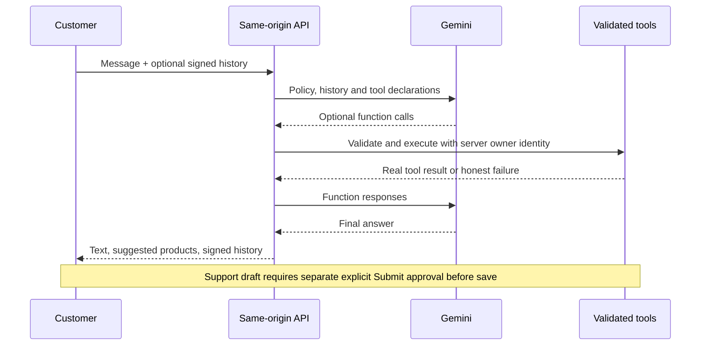

# Workflows and automation evidence

[README](../README.md) · [Architecture](architecture.md) · [Testing](testing.md)

**Inspection date: 13 November 2026.** Status words are intentional: implemented in source, observed in live configuration, unverified externally, or proposed. No live order or email was created to manufacture evidence.

## 1. Customer order workflow — implemented

1. Add product IDs/quantities to the browser cart. No order is created at this step.
2. Review/edit the cart, proceed to checkout, enter fictional details and acknowledge simulation.
3. Submit a persistent owner-scoped idempotency key plus payload. The server validates it and computes a fingerprint.
4. Supabase RPC loads product facts and saves an order, item snapshots and any tracked stock change in one transaction.
5. The browser fetches confirmation using the same session/reference/email and displays the stored statuses. Retrying the identical request does not create a second order.
6. Database AFTER INSERT webhooks may initiate external processing. Their existence does not certify successful downstream processing.

Customer UI and database persistence are covered by local browser/API/schema tests. Production readiness read was verified, not a new production write. See [test layers](testing.md).

## 2. Make order acknowledgement — partially verified

### Evidence available

- Source review found no Make blueprint/export, application-side Make webhook call, acknowledgement email renderer, mail SDK, Klaviyo code or notification-status migration.
- Read-only live `pg_trigger` metadata showed **two enabled `supabase_functions.http_request` triggers on `glowlab.orders`**, both AFTER INSERT, neither UPDATE nor DELETE. A boolean-only check of their arguments confirmed **two Make destinations**. Private destinations/headers are not included here.
- The inspected live order columns contain order/customer/payment/fulfilment fields but **no notification-status fields**. Local migrations also contain no notification outbox or status contract.
- The available connector does not support Make scenario inspection. No scenario module mapping, run history, authenticated external order retrieval or email/provider delivery evidence was available.

The two hooks are not evidence of two successful deliveries. They are a concrete **duplicate-processing risk** that needs review of intent, routes and scenario idempotency. No hook was disabled or changed during this audit.

### Actual vs intended boundary

```mermaid
flowchart LR
    A[Committed order and item snapshots] --> B[Two enabled AFTER INSERT HTTP triggers]
    B -. Make destination configured .-> C[Make webhook listener]
    C -. unverified .-> D[Retrieve order AND order_items]
    D -. unverified .-> E[Validate and aggregate lines]
    E -. unverified .-> F[Render acknowledgement]
    F -. unverified .-> G[Email provider]
    G -. unverified .-> H[Record notification outcome]
```

Only the database trigger configuration is directly observed. Dashed downstream steps are the requested workflow to verify, **not a reverse-engineered scenario or a working export**.

| Step                       | Current evidence                                                                                    | What is still required                                                                                                                               |
| -------------------------- | --------------------------------------------------------------------------------------------------- | ---------------------------------------------------------------------------------------------------------------------------------------------------- |
| Order INSERT               | Transaction/RPC implemented and tested locally; prior private integration evidence archived.        | Approved isolated end-to-end event, not a fake production customer order.                                                                            |
| Trigger → Make             | Two enabled INSERT hooks with Make destinations observed.                                           | Confirm which endpoint/scenario is active/intended and whether requests are authenticated/received.                                                  |
| Retrieve order details     | Adapter/SQL can expose owner-scoped application data; Make mapping unavailable.                     | Inspect the scenario's private authorized connection, event/order ID mapping and committed-row retry. Do not expose a service-role key to customers. |
| Retrieve line items        | `order_items.order_id` relationship exists. No separate item retrieval/aggregation module verified. | Query by the actual order UUID, include every line, quantity, unit price and line total; handle empty/partial results.                               |
| Generate acknowledgement   | No template or scenario export available.                                                           | Review actual template/mapped variables, escaping, currency and simulation disclosure; do not claim a real payment or dispatch.                      |
| Send email                 | No sender configuration, receipt or inbox proof available.                                          | Verify credentials privately, sender/domain setup, provider response, controlled inbox result and bounce/failure handling.                           |
| Update notification status | No such order columns observed; no implementation in migrations/source.                             | Inspect whether an external data store is used. Otherwise design/review the status contract before applying any schema change.                       |

### Open issues — not fixed

**Missing product line items.** The schema separates orders from items. A trigger on orders is not itself a complete line-item email. Without the actual scenario, missing lines cannot be confirmed or declared fixed. Inspect order-ID mapping, item query, iterator/array aggregator and template mapping. Suppress a misleading total-only acknowledgement if mandatory lines are unavailable; route the failure for review.

**Email delivery and spam classification.** A successful Make run or provider acceptance is not inbox placement. Verify sender authentication (SPF/DKIM/DMARC where applicable), message headers, a controlled recipient, spam folder and bounce events. These are checklist items, not claims that a DNS issue was found. Never commit mail headers, recipient data or credentials unredacted.

**Duplicates and retries.** There are two live INSERT hooks. Order idempotency prevents repeated checkout INSERTs under the same key, but it does not deduplicate webhook redelivery or two scenarios. Review both hooks before removing either. A proposed notification key is `(order_id, notification_type)`, claimed atomically before sending. A simple read-then-send filter is race-prone. Persist provider message IDs and distinguish retryable failures from already-sent outcomes. None of this notification deduplication is implemented or verified here.

**Uncertain outcomes.** A timeout after the provider accepts a message must not blindly resend as if nothing happened. Reconcile by stored provider ID/idempotency capability where available. Bound retry attempts/backoff and keep a failure queue or reviewed execution log. A sender failure must not mark an order cancelled, unpaid or dispatched.

**Notification state.** If no external state already exists, a reviewed migration could add a dedicated notification/outbox table with order ID, type, attempt count, safe failure category, claimed/sent timestamps and provider message reference. This is a **proposal**, not a migration delivered or applied in this task. Order/payment/fulfilment state should stay independent.

**Item commit timing and scope.** Database HTTP hooks can enqueue asynchronously during the transaction. Make should retrieve committed order/item data with bounded retry, validate expected lines/totals and use a least-privilege integration rather than widening public table access. This safeguard has not been verified in the scenario.

**Privacy and truthful acknowledgement.** Include only the minimum recipient/order information required. Do not send customer delivery/medical data to an LLM to compose a simple acknowledgement. Use a deterministic escaped template where sufficient. The current checkout is simulated: acknowledgement must not imply a real charge, guaranteed delivery or shipment.

### Evidence needed from the owner

Provide a **sanitised** Make blueprint and redacted run/module configuration, or grant supported scenario inspection access. Remove webhook endpoints, API keys, connection IDs/tokens, recipient names/emails/addresses, order references and raw payloads. Do not paste an unsanitised export into chat. There is no scenario export in this repository and no fabricated blueprint has been added.

Then review: intended trigger → event validation → order/item query → aggregation → notification claim → template → sender → sent/failure persistence → retry/reconciliation. Use a dedicated staging workflow and controlled test recipient with explicit permission. No production test order/email should be generated merely for a portfolio screenshot.

## 3. Lumi conversation and support workflow — implemented with limits

Five tools exist; there is no runtime scripted AI response or provider fallback. Transient generation-only retry does not replay tools. An AI support draft is not a saved ticket, a staffed handoff or an email. Explicit UI approval persists through `create_customer_ticket`; that stored ID is the success signal. There is no verified human-notification/response SLA.

## 4. Workflows not implemented in this revision

- Groq-primary → Gemini-fallback routing and corresponding live/fault tests.
- Immediate Add to Cart → checkout redirect and checkout-side line editing.
- Real payment provider events, shipments, physical refunds, seller analytics, marketing emails or Klaviyo flows.

Existing external configurations are preserved. Their absence from source is not proof that no external scenario exists; it is a reason to require evidence before making portfolio claims.
